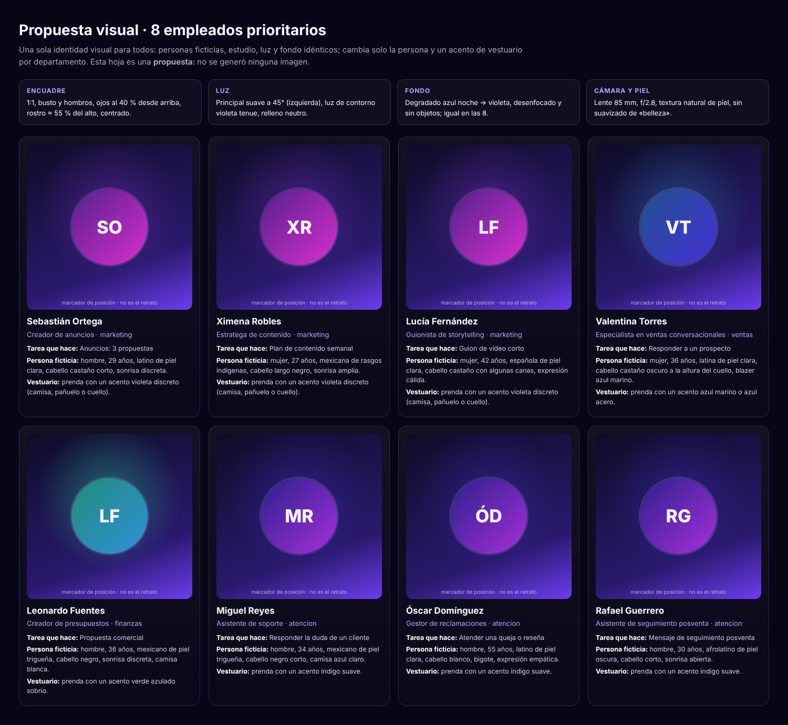

# Propuesta visual · retratos de los 8 empleados prioritarios

**Estado: propuesta. No se generó ninguna imagen y no se gastó nada.** Los 41 retratos tampoco: solo estos 8 se proponen para una primera tanda, y solo con tu autorización y el costo a la vista.


(La hoja usa marcadores de posición; la genera `scripts/employees/propuesta_retratos.ts`.)

## Los 8 seleccionados y por qué
Son quienes **ejecutan las 8 tareas guiadas** del PR #3 y aparecen en la sección de tareas de la landing: si el cliente las usa, su cara es lo primero que ve.

| # | Empleado | Puesto | Departamento | Tarea guiada |
|---|---|---|---|---|
| 1 | Sebastián Ortega | Creador de anuncios | Marketing | Anuncios: 3 propuestas |
| 2 | Ximena Robles | Estratega de contenido | Marketing | Plan de contenido semanal |
| 3 | Lucía Fernández | Guionista de storytelling | Marketing | Guion de video corto |
| 4 | Valentina Torres | Especialista en ventas conversacionales | Ventas | Responder a un prospecto |
| 5 | Leonardo Fuentes | Creador de presupuestos | Finanzas | Propuesta comercial |
| 6 | Miguel Reyes | Asistente de soporte | Atención al cliente | Responder la duda de un cliente |
| 7 | Óscar Domínguez | Gestor de reclamaciones | Atención al cliente | Atender una queja o reseña |
| 8 | Rafael Guerrero | Asistente de seguimiento posventa | Atención al cliente | Mensaje de seguimiento posventa |

**Diversidad:** edades de 27 a 55, rasgos y tonos de piel variados (el catálogo ya define a cada persona). **Desequilibrio a decidir:** hay 3 mujeres y 5 hombres. Opción: cambiar la identidad de Leonardo Fuentes o Miguel Reyes por una mujer para quedar 4/4 (cambia `src/features/employees/catalog.ts`; no se hizo).

## Identidad visual consistente (guía de estilo)
- **Formato:** 1:1, busto y hombros, ojos al 40 % desde arriba, rostro ≈ 55 % del alto, centrado.
- **Luz:** principal suave a 45° frontal izquierda, contorno violeta tenue, relleno neutro.
- **Fondo:** degradado azul noche (#0d0c26) → violeta (#6d3df0), desenfocado y sin objetos; **idéntico en las 8**.
- **Cámara y piel:** lente 85 mm, f/2.8, textura natural, sin suavizado de «belleza».
- **Vestuario:** atuendo profesional con **un acento de color por departamento** (marketing violeta, ventas azul marino, atención índigo, finanzas verde azulado) para que el equipo se lea como familia.
- **Expresión:** serena y cercana, con variaciones leves.
- **Salida final:** WebP 512×512 (`scripts/employees/importar_fotos.py`), < 60 KB cada uno.
- **Honestidad:** en la interfaz siempre «Empleado IA · imagen ilustrativa»; personas ficticias, sin parecido a personas reales ni famosos.

## Método para que salgan consistentes
1. Misma herramienta y mismo modelo para las 8. 2. Mismo prefijo y sufijo en todos los prompts (abajo); cambia solo la persona y el acento de vestuario. 3. Generar primero **un retrato ancla** (Valentina Torres), aprobarlo y usarlo como **referencia de estilo** para los demás (los modelos con «image references» —p. ej. la familia Nano Banana— lo permiten) y fijar la **semilla** cuando el modelo la admita. 4. Revisión humana de cada retrato con la lista siguiente; lo que no pase se regenera.

**Lista de revisión:** ¿manos o dientes extraños? ¿simetría y ojos naturales? ¿mismo fondo y luz que el ancla? ¿sin texto ni logos? ¿se parece a alguien real? ¿edad y rasgos coinciden con el catálogo? ¿se ve bien recortado a círculo de 64 px?

## Prompts (listos para usar)
### Sebastián Ortega — Creador de anuncios (`creador-anuncios`)

```
Square 1:1 studio headshot, head and shoulders, subject centered, eyes at 40% from the top, face about 55% of the frame height, looking at the camera. Soft key light from front-left at 45°, faint violet rim light, neutral fill. Background: smooth out-of-focus gradient from deep midnight blue (#0d0c26) to violet (#6d3df0), no objects. 85mm lens, f/2.8, natural skin texture, no beauty smoothing, photorealistic. Subject: a fictional 29-year-old man, latino de piel clara, cabello castaño corto, sonrisa discreta. Wardrobe: smart professional attire with a discreet violet accent in the clothing (shirt, scarf or collar). Calm, confident, approachable expression. No text, no logos, no watermark, no jewelry with symbols. A fictional person; must not resemble any real individual or celebrity.
```

### Ximena Robles — Estratega de contenido (`estratega-contenido`)

```
Square 1:1 studio headshot, head and shoulders, subject centered, eyes at 40% from the top, face about 55% of the frame height, looking at the camera. Soft key light from front-left at 45°, faint violet rim light, neutral fill. Background: smooth out-of-focus gradient from deep midnight blue (#0d0c26) to violet (#6d3df0), no objects. 85mm lens, f/2.8, natural skin texture, no beauty smoothing, photorealistic. Subject: a fictional 27-year-old woman, mexicana de rasgos indígenas, cabello largo negro, sonrisa amplia. Wardrobe: smart professional attire with a discreet violet accent in the clothing (shirt, scarf or collar). Calm, confident, approachable expression. No text, no logos, no watermark, no jewelry with symbols. A fictional person; must not resemble any real individual or celebrity.
```

### Lucía Fernández — Guionista de storytelling (`guionista-storytelling`)

```
Square 1:1 studio headshot, head and shoulders, subject centered, eyes at 40% from the top, face about 55% of the frame height, looking at the camera. Soft key light from front-left at 45°, faint violet rim light, neutral fill. Background: smooth out-of-focus gradient from deep midnight blue (#0d0c26) to violet (#6d3df0), no objects. 85mm lens, f/2.8, natural skin texture, no beauty smoothing, photorealistic. Subject: a fictional 42-year-old woman, española de piel clara, cabello castaño con algunas canas, expresión cálida. Wardrobe: smart professional attire with a discreet violet accent in the clothing (shirt, scarf or collar). Calm, confident, approachable expression. No text, no logos, no watermark, no jewelry with symbols. A fictional person; must not resemble any real individual or celebrity.
```

### Valentina Torres — Especialista en ventas conversacionales (`vendedor-conversacional`)

```
Square 1:1 studio headshot, head and shoulders, subject centered, eyes at 40% from the top, face about 55% of the frame height, looking at the camera. Soft key light from front-left at 45°, faint violet rim light, neutral fill. Background: smooth out-of-focus gradient from deep midnight blue (#0d0c26) to violet (#6d3df0), no objects. 85mm lens, f/2.8, natural skin texture, no beauty smoothing, photorealistic. Subject: a fictional 36-year-old woman, latina de piel clara, cabello castaño oscuro a la altura del cuello, blazer azul marino. Wardrobe: smart professional attire with a discreet navy-blue accent in the clothing. Calm, confident, approachable expression. No text, no logos, no watermark, no jewelry with symbols. A fictional person; must not resemble any real individual or celebrity.
```

### Leonardo Fuentes — Creador de presupuestos (`creador-presupuestos`)

```
Square 1:1 studio headshot, head and shoulders, subject centered, eyes at 40% from the top, face about 55% of the frame height, looking at the camera. Soft key light from front-left at 45°, faint violet rim light, neutral fill. Background: smooth out-of-focus gradient from deep midnight blue (#0d0c26) to violet (#6d3df0), no objects. 85mm lens, f/2.8, natural skin texture, no beauty smoothing, photorealistic. Subject: a fictional 36-year-old man, mexicano de piel trigueña, cabello negro, sonrisa discreta, camisa blanca. Wardrobe: smart professional attire with a sober teal-green accent in the clothing. Calm, confident, approachable expression. No text, no logos, no watermark, no jewelry with symbols. A fictional person; must not resemble any real individual or celebrity.
```

### Miguel Reyes — Asistente de soporte (`agente-soporte`)

```
Square 1:1 studio headshot, head and shoulders, subject centered, eyes at 40% from the top, face about 55% of the frame height, looking at the camera. Soft key light from front-left at 45°, faint violet rim light, neutral fill. Background: smooth out-of-focus gradient from deep midnight blue (#0d0c26) to violet (#6d3df0), no objects. 85mm lens, f/2.8, natural skin texture, no beauty smoothing, photorealistic. Subject: a fictional 34-year-old man, mexicano de piel trigueña, cabello negro corto, camisa azul claro. Wardrobe: smart professional attire with a soft indigo accent in the clothing. Calm, confident, approachable expression. No text, no logos, no watermark, no jewelry with symbols. A fictional person; must not resemble any real individual or celebrity.
```

### Óscar Domínguez — Gestor de reclamaciones (`gestor-reclamaciones`)

```
Square 1:1 studio headshot, head and shoulders, subject centered, eyes at 40% from the top, face about 55% of the frame height, looking at the camera. Soft key light from front-left at 45°, faint violet rim light, neutral fill. Background: smooth out-of-focus gradient from deep midnight blue (#0d0c26) to violet (#6d3df0), no objects. 85mm lens, f/2.8, natural skin texture, no beauty smoothing, photorealistic. Subject: a fictional 55-year-old man, latino de piel clara, cabello blanco, bigote, expresión empática. Wardrobe: smart professional attire with a soft indigo accent in the clothing. Calm, confident, approachable expression. No text, no logos, no watermark, no jewelry with symbols. A fictional person; must not resemble any real individual or celebrity.
```

### Rafael Guerrero — Asistente de seguimiento posventa (`seguimiento-posventa`)

```
Square 1:1 studio headshot, head and shoulders, subject centered, eyes at 40% from the top, face about 55% of the frame height, looking at the camera. Soft key light from front-left at 45°, faint violet rim light, neutral fill. Background: smooth out-of-focus gradient from deep midnight blue (#0d0c26) to violet (#6d3df0), no objects. 85mm lens, f/2.8, natural skin texture, no beauty smoothing, photorealistic. Subject: a fictional 30-year-old man, afrolatino de piel oscura, cabello corto, sonrisa abierta. Wardrobe: smart professional attire with a soft indigo accent in the clothing. Calm, confident, approachable expression. No text, no logos, no watermark, no jewelry with symbols. A fictional person; must not resemble any real individual or celebrity.
```


## Costo (a la vista antes de generar)
**No puedo afirmar un precio:** los catálogos de modelos de imagen disponibles en esta sesión (Buzzy e Higgsfield) **no publican el costo por imagen**, y la cuenta de Higgsfield conectada aparece en plan gratuito con **0.28 créditos**, que no alcanzan para esta tanda. Lo que sí se puede decir:
- **Volumen:** 1 retrato ancla + 7 retratos = **8 finales**; con una tasa de reintentos de hasta el 100 % (consistencia y revisión humana), **hasta 16–17 generaciones** como máximo. Resolución 1K–2K es suficiente (se reduce a 512 px).
- **Costo total = (nº de generaciones) × (costo por imagen que muestre la herramienta)**. Con costo por imagen = X: mínimo **8X**, esperado **≈ 12X**, máximo **17X**.
- **Primer paso propuesto (cuesta una sola imagen):** generar solo el ancla, ver el cargo real en créditos y recién entonces fijar el presupuesto de la tanda. Hasta tu «sí» a ese gasto, no se genera nada.
- Alternativa sin costo: dejar los monogramas (ya funcionan) o pedir fotografías de modelos reales con licencia (fuera de alcance; no recomendado: los empleados son IA).

**Decisiones que necesito de ti:** (1) ¿Apruebas los 8? (2) ¿4/4 de género y con qué cambio? (3) ¿Autorizas gastar créditos en **una** imagen de prueba (el ancla) y en qué servicio/plan? (4) Tope de gasto para la tanda.
